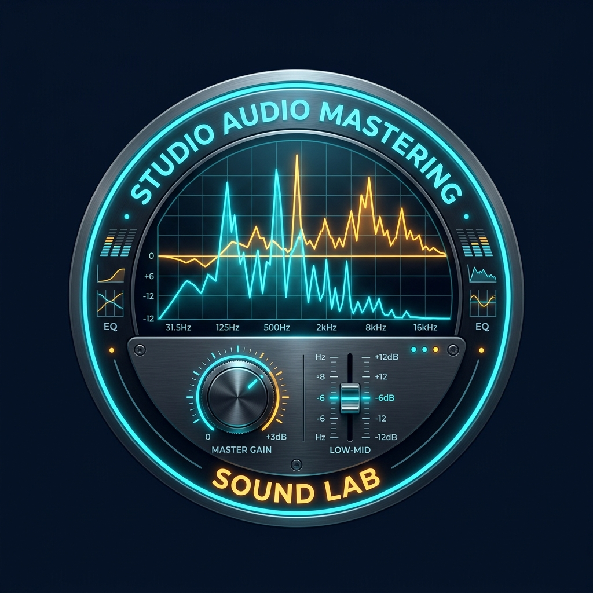

# DSP Lab - Studio Equalizer & Audio Telemetry Suite

A studio-grade Android Audio Equalizer, Digital Signal Processing (DSP) Rack, and Acoustics Laboratory app built with Jetpack Compose & Kotlin.



## Features

- **10-Band ISO Graphic & Parametric Equalizer**:
  - Interactive frequency response curve (20 Hz - 20 kHz) with real-time draggable nodes.
  - 10 ISO calibrated studio faders (31Hz, 62Hz, 125Hz, 250Hz, 500Hz, 1kHz, 2kHz, 4kHz, 8kHz, 16kHz) with ±15 dB range.
  - High-Pass Filter (HPF / Low Cut) & Low-Pass Filter (LPF / High Cut).
  - Pre-Amp gain calibration (-12 dB to +12 dB).
- **Acoustic Reverb & Room Simulator**:
  - Algorithmic Schroeder-Moorer reflection engine.
  - Room Size, Decay Time (0.2s - 8.0s), Wet/Dry Mix, HF Damping, Pre-Delay, and Diffusion.
  - Presets: *Studio Live, Vocal Plate, Cathedral Vault, Club Arena, Warm Chamber, Concert Hall, Space Ambient*.
- **Studio Dynamic Compressor & Limiter**:
  - VCA envelope detection, Threshold, Ratio, Attack, Release, and Makeup Gain.
  - Real-time Gain Reduction (GR) dynamic meter.
  - Lookahead Peak Limiter with Ceiling control (-12 to 0 dBFS).
- **3D Spatial Audio & Analog Coloration**:
  - 3D Binaural Virtualizer & Stereo Width Expander (0% Mono to 200% Super-Wide).
  - Channel Phase Inversion (0°, L 180°, R 180°, Out of Phase).
  - Analog Tube Warmth, Tape Saturation, Sub-Bass Synthesizer, High-End Exciter, and Vocal De-Esser.
- **Laboratory Signal Generator**:
  - Pure waveforms: Sine, Square, Triangle, Sawtooth with fine stepper tuning.
  - Noise Generator: Pink Noise (1/f Kellet standard), White Noise, and Brown Noise.
  - 20 Hz -> 20,000 Hz Logarithmic Chirp Sweep.
  - 1,000 Hz 0 dBFS reference tone and Binaural Brainwave Entrainment (Delta, Theta, Alpha, Beta, Gamma).
  - Built-in multi-instrument studio groove playback.
- **Real-Time Telemetry & Scopes**:
  - Segmented Dual Stereo VU Meters with red Clip/Overload LED.
  - 64-band FFT Spectrum Analyzer with peak hold.
  - CRT Phosphor Dual-beam Oscilloscope with trigger.
  - DAC stream telemetry: Sample Rate, Bit Depth, Buffer Size, Latency, and Estimated THD.
  - Laboratory preset manager to save and load custom user calibrations.

## Cara Rilis / Download APK di GitHub

### 1. Otomatis via GitHub Actions
Repo ini sudah dilengkapi dengan `.github/workflows/build-apk.yml`:
1. Push branch `main` atau `master` ke repositori GitHub Anda.
2. Setiap kali Anda membuat tag baru (misalnya `v1.0.0`) atau membuat **Release** di GitHub:
   ```bash
   git tag v1.0.0
   git push origin v1.0.0
   ```
3. GitHub Actions akan otomatis mengompilasi APK dan melampirkan file `DSP-Lab-v1.0.apk` langsung di halaman **Releases** GitHub Anda.
4. Anda juga dapat mengunduh APK dari tab **Actions** > **Build APK** > **Artifacts** (`DSP-Lab-APK`).

### 2. Export / Unduh Langsung dari Google AI Studio
- Di bagian pojok kanan atas layar AI Studio, klik menu **Settings** atau tombol **Export**.
- Pilih **Push to GitHub** untuk mengekspor repositori langsung ke akun GitHub Anda, atau
- Pilih **Download APK** untuk mengunduh file instalasi langsung ke perangkat Anda.

### 3. Build Mandiri (Lokal)
```bash
gradle assembleDebug
# File APK akan tersedia di:
# app/build/outputs/apk/debug/app-debug.apk
```
